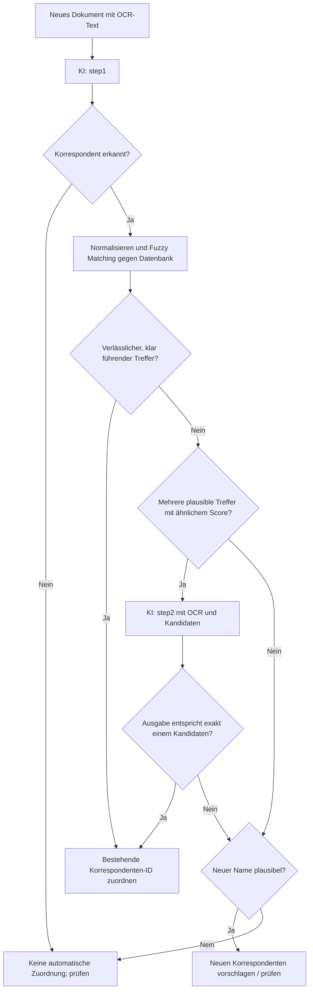

# Korrespondentenerkennung und -zuordnung in Paperless-ngx

## Ziel

Neue Dokumente sollen möglichst zuverlässig einem der bereits vorhandenen ca. 1.000 Korrespondenten zugeordnet werden. Neue Korrespondenten werden nur vorgeschlagen, wenn kein passender vorhandener Eintrag nachgewiesen werden kann. Eine zweite KI-Abfrage soll **nur bei mehrdeutigen Fuzzy-Ergebnissen** erfolgen, nicht bei jedem Dokument.

## Vorhandene Prompts

- **`step1` – Extraktion:** Liest den OCR-Text und ermittelt den wahrscheinlichsten externen Korrespondenten unter Berücksichtigung der definierten internen Personen und der Absender-/Empfängerregeln.
- **`step2` – Disambiguierung:** Erhält OCR-Text und mehrere ähnlich gut passende vorhandene Korrespondenten. Prüft, welcher Kandidat tatsächlich gemeint ist, und gibt dessen Datenbanknamen exakt zurück. Passt keiner, kann ein neuer Name ausgegeben werden; ist nichts bestimmbar, `KEINEN-GEFUNDEN`.

Die vollständigen Prompt-Texte werden hier bewusst nicht dupliziert, da sie bereits unter `step1` und `step2` gespeichert sind.

## Ablauf



## Schritt 1: Namen aus dem OCR-Text ermitteln

Den gespeicherten Prompt **`step1`** ausführen. Ziel ist ein Korrespondentenname, nicht zwingend schon der exakte Name aus der Datenbank.

- Interne Personen dienen zur Unterscheidung zwischen Absender und Empfänger.
- Bei Rechnungen, Bescheiden und ähnlichen Dokumenten ist üblicherweise die ausstellende Organisation relevant, nicht der unterzeichnende Mitarbeiter.
- Rechtsformen (z. B. GmbH, AG, e. V.) möglichst erhalten.
- `KEINEN-GEFUNDEN` bzw. ein leerer oder ungültiger Name führt zur manuellen Prüfung statt zu einem spekulativen Datenbankabgleich.

## Schritt 2: Fuzzy Matching ohne KI

Den extrahierten Namen mit den bestehenden Korrespondenten vergleichen. Geeignet ist etwa **RapidFuzz**. Vor dem Vergleich können Leerzeichen, Groß-/Kleinschreibung, Interpunktion und offensichtliche OCR-Varianten vereinheitlicht werden.

**Wichtig:** Die Normalisierung darf unterscheidende Merkmale nicht unkritisch entfernen. Rechtsformen, Ortszusätze, Niederlassungen und Begriffe wie *Lebensversicherung* gegenüber *Versicherung* können unterschiedliche Rechtsträger kennzeichnen. Die Originalnamen bleiben für die endgültige Ausgabe erhalten.

Pro Kandidat mindestens speichern:

- Datenbank-ID und vollständiger Originalname
- Fuzzy Score auf einer einheitlichen Skala von 0 bis 100
- optional: Aliasnamen oder zusätzliche Identifikationsmerkmale

Die Kandidaten nach Score sortieren; die Score-Differenz berechnen:

`score_gap = bester_score - zweiter_score`

## Entscheidung: Wann wird `step2` aufgerufen?

Die folgenden Werte sind **Beispiel-Startwerte**, keine validierten Qualitätsgrenzen:

| Situation | Beispielregel | Aktion |
|---|---|---|
| Sehr guter, deutlich führender Treffer | Top-Score ≥ 95 **und** Abstand ≥ 8 | Bestehende ID direkt zuordnen |
| Mehrere plausible Kandidaten, knapp beieinander | Top-Score ≥ 80 **und** Abstand < 8 | `step2` aufrufen |
| Kein ausreichend plausibler Treffer | Top-Score < 80 | Neuen Namen vorschlagen bzw. manuell prüfen |
| Nur mittelmäßiger Treffer trotz großen Abstands | z. B. Top-Score 89 und Abstand 20 | **Nicht** allein aufgrund des Abstands automatisch mergen; prüfen |

Bei nur einem Kandidaten ist kein Score-Abstand definiert. Automatisch zuordnen nur bei hinreichend starker Identitätsbestätigung; andernfalls prüfen. Ein hoher Fuzzy Score kann aus zufällig ähnlichen Namen entstehen. Für produktive Automatisierung Schwellenwerte mit einer Stichprobe echter Dokumente kalibrieren.

### Beispiel-Pseudocode

```python
if extracted_name == "KEINEN-GEFUNDEN":
    manual_review()
elif not matches or matches[0].score < 80:
    review_new_correspondent(extracted_name)
else:
    top = matches[0]
    second = matches[1] if len(matches) > 1 else None
    gap = top.score - second.score if second else None

    if top.score >= 95 and (second is None or gap >= 8):
        assign_existing_correspondent(top.id)
    elif second is not None and top.score >= 80 and gap < 8:
        result = run_step2(ocr_text, plausible_candidates(matches))
        validate_step2_result(result, matches)
    else:
        manual_review()
```

## Schritt 3: KI nur zur Auflösung mehrdeutiger Treffer

**`step2`** wird nur im Mehrdeutigkeitsfall aufgerufen. Eingaben:

1. Originaler OCR-Text des Dokuments.
2. Eine überschaubare Liste der eng beieinanderliegenden Kandidaten, typischerweise **3–5**, sofern so viele plausibel sind.
3. Optional deren Aliasnamen. Fuzzy Scores können als zusätzliche Hinweise übergeben werden, dürfen aber keinen OCR-basierten Identitätsnachweis ersetzen.

Die Aufgabe von `step2` ist **nicht**, den höchsten Fuzzy Score automatisch zu bestätigen, sondern tatsächliche Identität anhand des Dokuments zu erkennen. Unterschiedliche Tochtergesellschaften oder Rechtsträger dürfen nicht allein wegen ähnlicher Namen zusammengeführt werden.

## Schritt 4: KI-Ausgabe strikt validieren

- **Exakter Name aus der übergebenen Kandidatenliste:** Datenbank-ID dieses Kandidaten verwenden. Idealerweise zusätzlich nur dann automatisch zuordnen, wenn die Entscheidung nach den eigenen Qualitätsregeln hinreichend sicher ist.
- **`KEINEN-GEFUNDEN`:** keine automatische Zuordnung.
- **Anderer Name:** als **neuen Vorschlag** behandeln, nicht als ID eines vermeintlich ähnlichen Datenbankeintrags. Vor Neuanlage erneut auf Duplikate prüfen.
- **Unzulässige Ausgabe** (mehrere Zeilen, Begründung, unbekannte Zusätze): nicht automatisch übernehmen, sondern prüfen.

Es ist empfehlenswert, ausschließlich vorhandene **IDs** für bestehende Korrespondenten zu speichern, statt bloße Namen nachträglich erneut unscharf aufzulösen.

## Betriebliche Empfehlungen

- **Deterministische KI-Einstellungen:** Temperature möglichst `0` oder `0,1`; Ausgaben kurz halten.
- **Sicherheit vor Vollautomatik:** Zweifelhafte Entscheidungen zur manuellen Prüfung geben. Falsche Zusammenführungen sind oft teurer als gelegentliche Rückfragen.
- **Protokollierung:** OCR-Extraktion, Top-Kandidaten, Scores, Gap, ggf. `step2`-Ausgabe und endgültig verwendete ID speichern.
- **Evaluation:** An einer Stichprobe korrekt zugeordneter Dokumente Precision, Anteil automatischer Zuordnungen und Häufigkeit von Step-2-Aufrufen messen. Grenzwerte anschließend anpassen.
- **Sonderfälle:** Namensänderungen, Marken vs. juristische Firmen, Tochtergesellschaften, Filialen, Versicherungen und Behörden gesondert testen.

## Kurzfazit

**`step1` → Fuzzy Matching → direkte Zuordnung bei eindeutigem Treffer; `step2` ausschließlich bei mehreren ähnlich plausiblen Treffern → strikte Validierung.** Fehlt eine belastbare Zuordnung, lieber einen neuen Korrespondenten zur Prüfung vorschlagen als einen falschen Merge auslösen.
